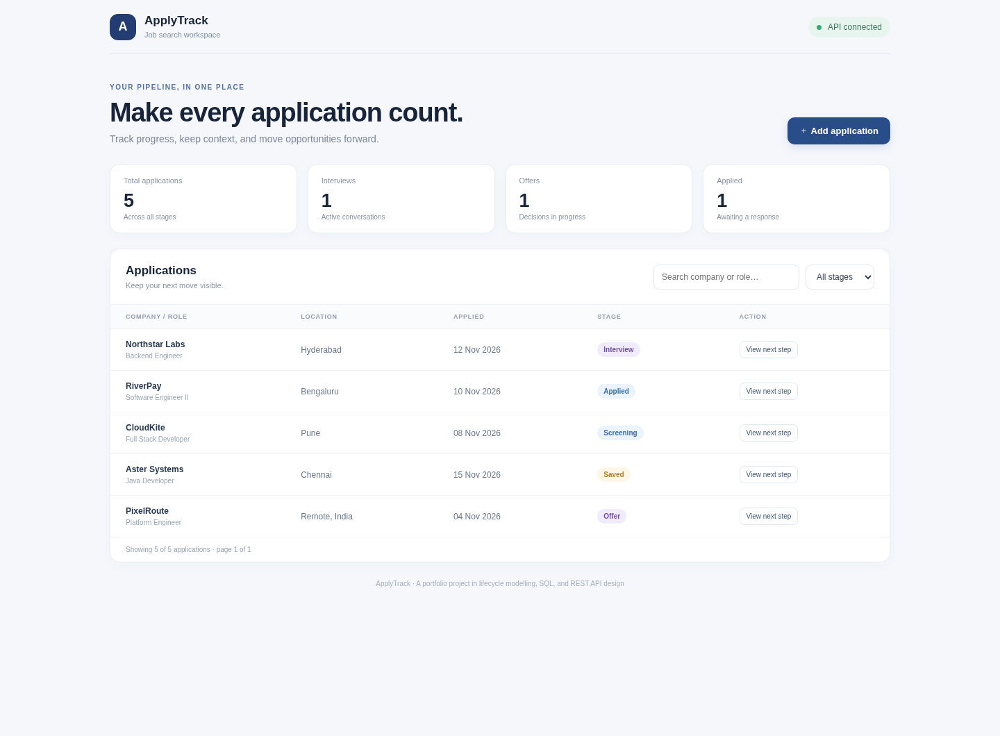

# ApplyTrack — job application pipeline

ApplyTrack is a full-stack portfolio project for managing a job search as a stateful workflow rather than a spreadsheet. It includes a JavaScript REST API, SQLite persistence, a responsive dashboard, an append-only activity history, and concurrency-safe edits.



## Why this project

It extends the career-tech workflow described in the resume with independently demonstrable backend engineering: domain-level state transitions, transactional audit logging, validation, filtering/pagination, and optimistic concurrency. It is a portfolio implementation, not a claim about ScoutBetter production code.

## Features

- Create and search applications; filter by lifecycle stage.
- Explicit state machine: `saved → applied → screening → interview → offer → accepted` with rejection/withdrawal exits.
- Rejects invalid transitions with `409 Conflict` and returns the allowed next states.
- Records creation, edits, and status changes in an application activity stream.
- Uses a `version` field for optimistic concurrency; stale updates receive `409`.
- SQLite foreign keys, indexes, constraints, and transactional writes.
- Responsive browser dashboard served by the same process.

## Stack

Node.js 22.5+ (ES modules), built-in `node:http`, built-in `node:sqlite`, SQL, HTML, CSS, vanilla JavaScript, and `node:test`. There are no third-party runtime dependencies.

## Setup

```bash
# 1. Install Node.js 22.5 or newer
node --version

# 2. Run from this project folder
npm start

# 3. Open the dashboard
# http://localhost:3001
```

The first launch creates `data/applytrack.sqlite`, applies `database/schema.sql`, and inserts five sample applications. Override defaults with environment variables:

```bash
PORT=3010 DB_PATH=./data/local.sqlite npm start
```

On Windows PowerShell:

```powershell
$env:PORT=3010; $env:DB_PATH='./data/local.sqlite'; npm start
```

## Run tests

```bash
npm test
npm run check
```

Tests use Node's native test runner and an in-memory SQLite database. No Docker service or external database is required.

## API reference

| Method | Endpoint | Purpose |
|---|---|---|
| GET | `/api/health` | Health check |
| GET | `/api/summary` | Counts by lifecycle stage |
| GET | `/api/applications?page=1&limit=20&q=java&status=interview` | Search/filter/paginate |
| POST | `/api/applications` | Create application |
| GET | `/api/applications/:id` | Read one application |
| PATCH | `/api/applications/:id` | Edit details; requires current `version` |
| POST | `/api/applications/:id/transition` | Move to a valid next stage |
| GET | `/api/applications/:id/activity` | Read audit history |

Example create request:

```bash
curl -X POST http://localhost:3001/api/applications \
  -H 'content-type: application/json' \
  -d '{"company":"Acme","role":"Backend Engineer","location":"Hyderabad","status":"applied"}'
```

Example transition:

```bash
curl -X POST http://localhost:3001/api/applications/REPLACE_ID/transition \
  -H 'content-type: application/json' \
  -d '{"status":"screening","details":"Recruiter call booked"}'
```

## Architecture

```text
Browser dashboard (HTML/CSS/JS)
          │ fetch /api/*
          ▼
Node HTTP server ── request validation / HTTP errors
          │
          ▼
Domain service ── lifecycle state machine / version checks
          │                └── audit event writes
          ▼
SQLite ── applications + activity tables / indexes
```

## Screenshots

- `screenshots/dashboard.png` — seeded dashboard with pipeline counts and application list.

## Engineering notes

- Status transitions are validated in the domain layer, not trusted to the UI.
- A transaction keeps the application update and audit event consistent.
- Optimistic concurrency is appropriate for edits where multiple tabs or API clients may update the same record.
- The demo has no user accounts or multi-tenant isolation. For production, add authenticated users, per-user authorization, CSRF protection for cookie-based sessions, migrations/versioning, structured logging, and deployment hardening.
